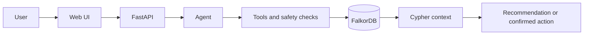

# Study Copilot

[](https://www.python.org/)
[](https://fastapi.tiangolo.com/)
[](https://www.falkordb.com/)
[](https://docs.docker.com/compose/)
[](https://pytest.org/)

Study Copilot is a graph-grounded learning assistant powered by FalkorDB. It helps a learner choose the next useful topic from connected progress, prerequisite, skill-gap, resource, and quiz data. Recommendations are grounded in Cypher results, while graph-changing actions require explicit confirmation.

## Why FalkorDB Matters

FalkorDB lets Study Copilot traverse the relationships between users, progress, topics, prerequisites, resources, quizzes, skill gaps, and study plans. That structure lets the agent answer not only “what should I study?” but also “why is this topic ready now?” and “which connected resource or quiz should follow?” Generic RAG or vector-only retrieval can find semantically similar documents, but it does not naturally enforce prerequisite paths, expose relationship evidence, or update connected learner state. The graph makes recommendations explainable and actions grounded in the learner’s actual learning path.

## Project Status

This repository is a minimal hackathon demo. The working end-to-end flow is:

1. Ask for the next topic.
2. Ask the agent to create a study plan.
3. Approve or reject the pending action in the UI.
4. Ask to update progress.
5. Approve or reject that pending action.

The same confirmation flow supports resource completion, quiz-attempt recording, and practice-question retrieval.

The deterministic agent works without an external LLM API key. The main actions are exposed through chat and the confirmation endpoint; there are no separate action-specific HTTP endpoints.

## Problem and Target User

Students often know they need to study but cannot decide what to do next. A flat list of resources does not show prerequisites, weak areas, or what fits the time available. Study Copilot is for learners who want an explainable next step and a small, confirmation-controlled study workflow.

## Architecture



The browser calls `/api/chat`. The agent first retrieves the user's graph context and eligible next topics. It then decides whether the request is a recommendation or a confirmation-gated mutation. Confirmed mutations are executed through `ActionService` and written to FalkorDB.

Recommendation responses include structured `evidence` and `blocked_candidates` fields. Evidence contains the selected topic, available time, progress/mastery, skill gap, connected resources and quizzes, and the relationship paths returned by FalkorDB. Blocked candidates explain which prerequisite is below the 0.70 mastery threshold.

## Graph Model

### Nodes

- `User`: `id`, `name`, `available_minutes`
- `Topic`: `id`, `name`, `difficulty`, `estimated_minutes`, `description`
- `Resource`: `id`, `title`, `kind`, `minutes`, `url`
- `Quiz`: `id`, `title`, `minutes`
- `QuizAttempt`: `id`, `score`, `created_at`
- `Progress`: `id`, `mastery`, `status`
- `SkillGap`: `id`, `severity`, `reason`
- `StudyPlan`: `id`, `title`, `status`, `created_at`
- `StudyPlanItem`: `status`, `order`

### Relationships

- `User -[:HAS_PROGRESS]-> Progress -[:FOR_TOPIC]-> Topic`
- `User -[:HAS_GAP]-> SkillGap -[:FOR_TOPIC]-> Topic`
- `Topic -[:PREREQUISITE_OF]-> Topic`
- `Topic -[:HAS_RESOURCE]-> Resource`
- `Topic -[:HAS_QUIZ]-> Quiz`
- `User -[:TOOK]-> QuizAttempt -[:FOR_QUIZ]-> Quiz`
- `User -[:COMPLETED_RESOURCE]-> Resource`
- `User -[:HAS_PLAN]-> StudyPlan -[:CONTAINS]-> StudyPlanItem -[:TARGETS]-> Topic`

The seed graph includes Python Functions, Data Structures, Recursion, and Python Testing. Python Functions is a prerequisite for Data Structures; Data Structures is a prerequisite for Recursion and Python Testing.

## Important Cypher

Find a user's progress and skill gaps:

```cypher
MATCH (u:User {id:$user_id})-[:HAS_PROGRESS]->(p:Progress)-[:FOR_TOPIC]->(t:Topic)
OPTIONAL MATCH (u)-[:HAS_GAP]->(g:SkillGap)-[:FOR_TOPIC]->(gt:Topic)
RETURN u, p, t, g, gt
```

Find prerequisite-ready topics within the learner's time budget:

```cypher
MATCH (u:User {id:$user_id})-[:HAS_PROGRESS]->(p:Progress)-[:FOR_TOPIC]->(done:Topic)
MATCH (candidate:Topic)
WHERE candidate <> done
  AND candidate.estimated_minutes <= $minutes
  AND NOT EXISTS {
    MATCH (prerequisite:Topic)-[:PREREQUISITE_OF]->(candidate)
    WHERE NOT EXISTS {
      MATCH (u)-[:HAS_PROGRESS]->(mp:Progress)-[:FOR_TOPIC]->(prerequisite)
      WHERE mp.mastery >= 0.7
    }
  }
OPTIONAL MATCH (u)-[:HAS_GAP]->(gap:SkillGap)-[:FOR_TOPIC]->(candidate)
OPTIONAL MATCH (candidate)-[:HAS_RESOURCE]->(resource:Resource)
RETURN candidate, gap, resource
ORDER BY coalesce(gap.severity, 0) DESC, candidate.difficulty ASC
```

Retrieve evidence connecting a user to a topic:

```cypher
MATCH path=(u:User {id:$user_id})-[*1..4]-(t:Topic {id:$topic_id})
RETURN [node IN nodes(path) | node] AS nodes,
       [rel IN relationships(path) | type(rel)] AS relationships
LIMIT 3
```

Create a confirmed study plan:

```cypher
MATCH (u:User {id:$user_id})
CREATE (u)-[:HAS_PLAN]->(plan:StudyPlan {
  id:$plan_id, title:$title, status:'active', created_at:$created_at
})
WITH plan
UNWIND $topic_ids AS topic_id
MATCH (topic:Topic {id:topic_id})
CREATE (plan)-[:CONTAINS]->
       (item:StudyPlanItem {status:'planned', order:0})-[:TARGETS]->(topic)
RETURN plan
```

Record a confirmed quiz attempt:

```cypher
MATCH (u:User {id:$user_id}), (q:Quiz {id:$quiz_id})
CREATE (u)-[:TOOK]->(attempt:QuizAttempt {
  id:$attempt_id, score:$score, created_at:$created_at
})-[:FOR_QUIZ]->(q)
RETURN attempt, q
```

## Agent Actions

Implemented actions:

- `recommend_next_topic`: read-only recommendation based on prerequisites, gaps, and time.
- `create_study_plan`: stages a plan creation action and requires approval.
- `mark_resource_complete`: stages a completion relationship and requires approval.
- `record_quiz_attempt`: stages a quiz result and requires approval.
- `update_progress`: stages a mastery update and requires approval.
- `generate_practice_questions`: stages retrieval of the topic's connected quiz.

The confirmation endpoint consumes a one-time action ID. Approved actions are executed and recorded in the service audit log; rejected actions are also logged. Invalid or expired IDs return HTTP 404.

Mutation requests must identify their graph records and provide numeric values instead of relying on demo defaults. Examples:

- `Build a study plan for Data Structures`
- `Mark "Choosing the Right Collection" complete`
- `Record quiz q_data with score 0.8`
- `Update progress for t_data to mastery 0.75`
- `What should I study next in 30 minutes?`

If a required topic, resource, quiz, score, or mastery value is missing, the agent asks a clarification question. IDs and names are resolved only against records returned from the requesting user's connected graph context.

## Local Setup

Requirements: Python 3.11+. Docker Desktop is the fastest way to run the complete demo because FalkorDB is a Redis module and does not provide a standard native Windows install.

### Recommended: Docker Desktop

```powershell
Copy-Item .env.example .env
docker compose up --build
```

This starts FalkorDB, seeds the graph, and serves the UI at <http://localhost:8000>.

### Without Docker

The backend and UI can still start without FalkorDB, but graph-backed chat and seeding will show an unavailable-database error. This is useful for checking the UI only; use Docker Compose for the working hackathon demo.

### PowerShell

```powershell
Copy-Item .env.example .env
python -m venv .venv
.\.venv\Scripts\Activate.ps1
python -m pip install --upgrade pip
pip install .
uvicorn app.main:app --reload
```

Open the UI at <http://localhost:8000>. The API documentation is at <http://localhost:8000/docs>.

### macOS/Linux

```bash
cp .env.example .env
docker compose up --build
```

For a host-run backend instead of the containerized app:

```bash
python3 -m venv .venv
source .venv/bin/activate
python -m pip install --upgrade pip
pip install .
python scripts/seed.py
uvicorn app.main:app --reload
```

Skip `scripts/seed.py` in this mode because no graph is available. Run the seed command only after FalkorDB is running.

To use a separately installed prebuilt FalkorDB-compatible Redis module, start it on `localhost:6379` and keep the default `.env` values. Do not build FalkorDB from source for this demo.

### Environment Variables

Copy `.env.example` to `.env`. Empty credentials are valid for the Docker FalkorDB image or a local prebuilt instance.

| Variable            | Default         | Purpose                                      |
| ------------------- | --------------- | -------------------------------------------- |
| `APP_ENV`           | `development`   | Runtime environment label                    |
| `LOG_LEVEL`         | `INFO`          | Python logging level                         |
| `FALKORDB_HOST`     | `localhost`     | FalkorDB hostname                            |
| `FALKORDB_PORT`     | `6379`          | FalkorDB port                                |
| `FALKORDB_USERNAME` | empty           | Optional database username                   |
| `FALKORDB_PASSWORD` | empty           | Optional database password                   |
| `FALKORDB_SSL`      | `false`         | Set `true` for TLS-enabled cloud connections |
| `FALKORDB_TIMEOUT`  | `5.0`           | Connection and query timeout in seconds      |
| `FALKORDB_GRAPH`    | `study_copilot` | FalkorDB graph name                          |
| `DEFAULT_USER_ID`   | `u_001`         | Default demo learner                         |
| `LLM_PROVIDER`      | `deterministic` | Agent provider mode                          |
| `LLM_MODEL`         | `gpt-4o-mini`   | Optional model name                          |
| `LLM_API_KEY`       | empty           | Optional LLM key; never commit it            |
| `LLM_BASE_URL`      | OpenAI URL      | Optional compatible API URL                  |

## API

- `GET /health`: returns `{ "ok": true }` when FalkorDB is reachable.
- `POST /api/chat`: accepts `{ "user_id": "u_001", "message": "What should I study next?" }`.
- `POST /api/actions/{action_id}/confirm`: accepts `{ "approved": true }` or `{ "approved": false }`.
- `GET /docs`: interactive OpenAPI documentation.

The UI checks `/health` on load and shows `graph online` or `graph unavailable` in the header. If the graph is unavailable, the backend and UI remain available for troubleshooting, while graph-backed chat and actions return a clear error until FalkorDB is reachable.

Example:

```powershell
Invoke-RestMethod http://localhost:8000/api/chat -Method Post -ContentType 'application/json' -Body '{"user_id":"u_001","message":"What should I study next?"}'
```

For a mutation request, use a message containing `plan` or `progress`. The response includes `pending_action_id`; send that ID to the confirmation endpoint.

## Demo Prompts

- `What should I study next?`
- `Create a study plan for me`
- `Update my progress`
- `Mark this resource complete`
- `Record a quiz attempt`
- `Retrieve connected practice questions`

Use the buttons in the UI or type the prompts. The right-hand context panel shows records retrieved from FalkorDB, and the action panel shows approval controls when needed.

## Demo

- [Demo video](https://youtu.be/Y1QhaLu1SWs)
- [Technical blog](https://dev.to/hamzawritescode/study-copilot-building-an-ai-agent-that-acts-on-connected-learning-data-4g76)

### Screenshot placeholders

Add the final screenshots to `docs/screenshots/` using these filenames:

- Chat recommendation: `docs/screenshots/chat-recommendation.png`
- Graph context: `docs/screenshots/graph-context.png`
- Confirmation card: `docs/screenshots/confirmation-card.png`
- Study plan result: `docs/screenshots/study-plan-result.png`

## Repository Layout

```text
app/                 FastAPI app, agent, database, repository, tools, schemas
app/static/          Chat UI
scripts/seed.py      Schema and sample graph loader
tests/               Unit and API tests
Dockerfile           Application image
docker-compose.yml   FalkorDB and app services
.env.example         Safe environment variable template
```

## Limitations and Future Improvements

The current demo uses a deterministic decision loop so it is reproducible and does not require an API key. Add a production LLM adapter, persistent audit events, authenticated users, richer plan ordering, richer question content, and broader integration tests before production use. The in-memory pending-action store is intentionally simple and is lost when the process restarts.

## License

MIT. See `LICENSE`.
